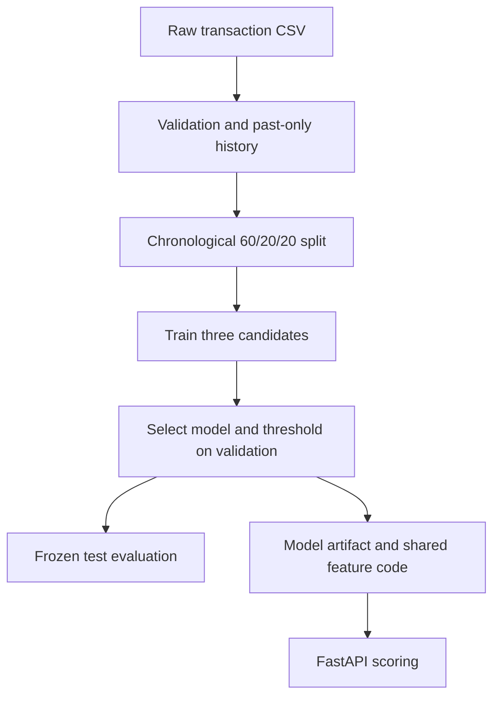

# PaymentGuard

Reproducible payment fraud classification with chronological evaluation and a FastAPI inference service.

**Status: working educational MVP. The bundled experiment uses synthetic transactions and simulated labels. Its scores and metrics do not establish real-world fraud detection performance.** No website, paid cloud account, or GPU is required.

## The question

How much fraud can a model detect while incorrectly flagging at most 1% of legitimate transactions on validation data? Does that frozen policy still meet its budget on later, unseen transactions?

This repository compares a constant-probability baseline, logistic regression, and histogram gradient boosting. It selects the model and threshold exclusively on validation data, then evaluates the selected policy once on test data. It reports false-alarm budget violations rather than silently adjusting the threshold on test data.

## Run locally

Use Python 3.12:

```bash
python -m venv .venv
source .venv/bin/activate
python -m pip install -r requirements.lock
python -m pip install --no-deps --no-build-isolation -e .
paymentguard generate --rows 30000 --seed 42
paymentguard train --data-kind synthetic --max-fpr 0.01
python -m unittest discover -s tests -v
uvicorn paymentguard.api:app --host 127.0.0.1 --port 8000
```

`requirements.lock` pins the tested runtime and its transitive dependencies. Package-registry access was blocked during development: tests ran with the installed versions, but a fresh online installation and a hosted Colab run could not be verified. On Windows, activate with `.venv\\Scripts\\activate`.

From a second terminal:

```bash
curl http://127.0.0.1:8000/ready
curl -X POST http://127.0.0.1:8000/predict \
  -H 'Content-Type: application/json' --data-binary @examples/transaction.json
python scripts/benchmark.py --requests 200
```

Interactive API documentation: <http://127.0.0.1:8000/docs>. Responses include the fraud score, frozen threshold, `allow`/`review` recommendation, model version, and data provenance. A score is not a verified calibrated probability; inspect the Brier score and reliability bins. `allow` is a demo policy result, not authorization to process a payment.

## Colab

Upload `notebooks/paymentguard_colab.ipynb` at <https://colab.research.google.com/>. Its first code cell prompts you to upload this project's ZIP, installs the locked dependencies, and runs the same package code used locally. It includes model comparison, evaluation, and an in-process API demonstration. It needs no public GitHub URL. After publishing the repo, cloning it can replace the ZIP-upload cell; record the commit hash for reproducibility.

## Pipeline and evaluation



- Splits use distinct timestamps, so simultaneous events never straddle partitions.
- Customer history excludes the current event and all events at the same timestamp. It uses no fraud labels. Prior observed validation/test events can update history, as in sequential online scoring.
- Scaling is fit on training data only. Gradient boosting's random internal early-stopping validation is disabled.
- Model selection prioritizes validation recall under the FPR budget, breaking ties by lower FPR, then higher average precision. Threshold comparison is `score >= threshold`; tied scores are handled together. A review-none policy is permitted.
- The final model remains fit on training data only. It is not refit on validation data, which would invalidate the selected threshold.
- Reports include average precision (not trapezoidal PR-AUC), ROC-AUC, precision, recall, FPR, review rate, confusion matrix, Brier score, reliability bins, and new-device/international slices.
- Reports record the data SHA-256, source-code hash, seed, package versions, split windows, and selected threshold. Exact numerical reproducibility is intended within the locked environment; cross-platform floating-point differences can occur.

`artifacts/report.json` is an actual generated run, not a promised result. `artifacts/benchmark.json` records a local sequential HTTP test, including warmup details; it is not a concurrent load or production capacity benchmark.

### Included synthetic run

The 30,000-event, seed-42 run selected logistic regression on validation. On 6,000 later test transactions (90 synthetic fraud labels), it detected 15 frauds and flagged 60 legitimate transactions: recall 16.67%, precision 20.00%, average precision 0.1404, and FPR 1.0152%. **The 1% false-positive budget was slightly exceeded on test.** This is deliberately reported as a failure of the frozen policy to meet its future budget, rather than retuning on test. These are synthetic demonstration results only.

## Files

| Path | Purpose |
| --- | --- |
| `src/paymentguard/data.py` | Synthetic generator, event validation, history, temporal split |
| `src/paymentguard/features.py` | Shared training/inference transformation |
| `src/paymentguard/train.py` | Candidate experiments, selection, provenance, saved artifact |
| `src/paymentguard/evaluate.py` | Threshold selection and metrics |
| `src/paymentguard/api.py` | Typed request validation, readiness, inference |
| `tests/test_system.py` | Leakage, chronology, tied scores, reproducibility, API parity |
| `notebooks/paymentguard_colab.ipynb` | Guided runnable walkthrough |
| `.github/workflows/ci.yml` | Test pipeline and publish evaluation artifact |

## Input contract and external data

An external CSV must contain `transaction_id`, `timestamp`, `customer_id`, `amount`, `distance_km`, `new_device`, `international`, and `is_fraud`. Use UTC-aware timestamps, nonnegative finite amounts and distances, unique transaction IDs, and binary flags/labels. `distance_km` means the distance from the customer's usual location; `new_device` and `international` must be known at scoring time. Monetary amounts must use one documented currency. Every temporal partition needs both classes.

```bash
paymentguard train --data path/to/mapped_transactions.csv --data-kind external --output artifacts/external
PAYMENTGUARD_MODEL=artifacts/external/model.joblib uvicorn paymentguard.api:app
```

There is deliberately no claim that an arbitrary fraud dataset already matches this schema. An actual public-data adapter and benchmark are the next milestone. Do not fill unavailable fields with invented values and interpret those as observed features.

The scoring API is stateless: callers provide `prior_txn_count_1h` (same-customer events in the inclusive prior hour, strictly before this timestamp) and `prior_mean_amount` (all strictly earlier same-customer amounts; zero for a new customer). A trusted upstream feature service must compute these consistently. The demo has no online feature store or event ingestion API. Timestamps sent to the API must include an offset; extra fields such as labels are rejected.

## Docker

Train locally first, then mount the resulting trusted artifacts:

```bash
docker build -t paymentguard .
docker run --rm -p 127.0.0.1:8000:8000 \
  --mount type=bind,source="$(pwd)/artifacts",target=/app/artifacts,readonly paymentguard
```

The image runs as a non-root user. An absent artifact leaves liveness healthy and readiness/scoring unavailable (503). Invalid or incompatible artifacts fail startup. Only load trusted joblib files: deserialization can execute code. No authentication or rate limiting is included; keep the demo local.

## Limitations and next milestones

The synthetic label mechanism is intentionally simple and known to the project author. Performance mainly measures recovery of that mechanism. The late-period feature shift is simulated. The demo assumes historical training labels are available at the split cutoff; a real experiment must account for chargeback delays and use an appropriate label-maturity gap. There is no automatic retraining, drift alerting, feature store, cloud deployment, or verified business impact in v0.1.

Next: add and document a real public dataset adapter; use forward-chaining backtests and uncertainty estimates; investigate probability calibration using an additional chronological holdout; then implement drift monitoring and challenger promotion. Add infrastructure only when the experiment needs it.

## Publish to GitHub

The delivered ZIP is ready to become a repository, but was not published remotely. From the extracted `paymentguard` folder, after reviewing the files:

```bash
git init -b main
git add .
git commit -m "Build PaymentGuard training pipeline and inference API"
gh auth login
gh repo create paymentguard --public --source=. --remote=origin --push
```

Use `--private` instead if desired. Generated raw data and joblib model files are excluded from Git; regenerate the model with `make demo`. GitHub Actions and Docker configurations are included but were not executed on their external platforms during this build.

Reference practices: [Made With ML](https://github.com/GokuMohandas/Made-With-ML), [MLOps Zoomcamp](https://github.com/DataTalksClub/mlops-zoomcamp), and the [Fraud Detection Handbook](https://github.com/Fraud-Detection-Handbook/fraud-detection-handbook). This implementation and synthetic generator are original to this project, not copied from those repositories.
